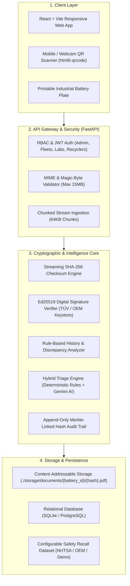

# VoltTrace — Every Battery Has a Story
### A Digital Battery Passport, Provenance Verification, and Triage Platform for EV Second-Life Applications

---

## 1. Executive Summary & Core Philosophy

**VoltTrace** is an enterprise-grade digital battery passport, evidence-verification, and second-life triage platform designed to power the resale, refurbishment, repurposing, and recycling of retired electric vehicle (EV) batteries.

### The Core Principle
> **VoltTrace is a *Triage and Trust Layer* for battery testing, not a substitute for physical testing.**
>
> Testing tells you what a battery is **right now**.  
> VoltTrace tells you **how it got there**, whether the seller’s evidence can be trusted, and **which batteries are worth spending 8–12 hours testing at all**.

### Epistemic Honesty (The Golden Rule)
VoltTrace explicitly distinguishes three separate concepts that naive systems conflate:
1. **Document Integrity $\ne$ Claim Truthfulness:** A matching cryptographic hash (SHA-256) proves a PDF was unaltered post-upload; it does *not* prove the numbers inside were truthful when generated.
2. **Digital Signature $\ne$ Safety Guarantee:** A valid Ed25519 signature proves origin by an accredited lab, but does not guarantee the battery is risk-free.
3. **Current Diagnostic Health $\ne$ Historical Evidence Quality:** Current physical condition and historical paper trail completeness are tracked, scored, and displayed independently.

---

## 2. Market & Regulatory Context

### A. Global Mandates
* **EU Regulation 2023/1542 (Battery Regulation):** Mandates digital battery passports by 2026/2027 tracking carbon footprint, material composition, and usage history.
* **CIRPASS Consortium:** Defines open European DPP standards, data carriers, and interoperability protocols.

### B. The Indian Market Reality Check
* **India's Battery Waste Management Rules (BWMR) 2022:** Mandates Extended Producer Responsibility (EPR) and end-of-life battery tracking for producers, refurbishers, and recyclers.
* **Reactive Maintenance Reality:** In India, maintenance is primarily reactive. A 24-month gap without a service record usually indicates normal, trouble-free operation—*not fraud*.
* **Absence of Evidence vs. Contradictions:**
  * **Absence of Records = Uncertainty:** Does not penalize the price artificially; instead, it widens the estimated valuation band (*"High uncertainty: physical test required"*).
  * **Contradictions = Red Flags:** Mathematically or physically impossible events (odometer rollbacks, +10% SoH jumps without module replacement, altered document hashes, or conflicting chemistry tags) trigger investigation warnings.
* **Target Audience:** Commercial fleets (e-rickshaws, e-2W delivery fleets like Zypp/Zomato, e-bus operators, cab fleets like BluSmart) and battery-swapping networks (Battery Smart, Sun Mobility). Fleets hold 80%+ of near-term retiring packs in India.

---

## 3. High-Level Technical Architecture



---

## 4. End-to-End Operational Workflow

### Step 1: Battery Registration & Industrial Placard Issuance
1. Fleet operator or OEM enters baseline parameters:
   * Unique Battery ID (e.g., `VT-1001-NMC-2023`).
   * Cell Chemistry (`NMC 811`, `LFP`, `NCA`).
   * Rated Capacity (kWh) & Nominal Voltage.
   * Manufacturing Date & Submitting Organisation.
2. System generates an **Industrial QR Placard** with:
   * Dynamic GS1 Digital Link QR code pointing to `/passport/{battery_id}`.
   * Human-readable nameplate specifications.
   * Regulatory compliance marks (CE, WEEE Recycling Bin, UN 38.3 transport safety).

### Step 2: Event-Driven Document Ingestion
Files are uploaded exclusively at natural operational milestones:
* **Milestone A:** Point of Sale or Vehicle Transfer.
* **Milestone B:** Workshop Maintenance / Pack Opening.
* **Milestone C:** Warranty / Insurance Claims.
* **Milestone D:** End-of-Life Inbound Intake at Recycler.

### Step 3: Security & Storage Processing
1. **Magic-Byte Inspection:** Enforces strict binary header inspection (blocks `.exe` or scripts disguised as `.pdf`).
2. **Chunked Hashing:** Computes SHA-256 over 64 KB memory chunks.
3. **Content-Addressable Storage (CAS):** Files are saved outside the SQL database to `./storage/documents/{battery_id}/{sha256_hash}.pdf` (or S3 WORM Object Lock in production).
4. **Signature Verification:** Validates Ed25519 cryptographic signatures against registered Public Keys of accredited inspection bodies (e.g., TÜV, DEKRA, OEM labs).

### Step 4: Consistency & Discrepancy Checking
The rules engine automatically checks:
* **The "Magic Rejuvenation" Check:** Flags positive SoH increases $>4\%$ unless accompanied by a verified `Module/Cell Replacement` invoice.
* **Chronological Anomaly Detection:** Flags odometer reversals or test dates predating battery manufacturing.
* **Cross-Field Conflict Check:** Flags conflicting chemistry or capacity specifications between documents.

### Step 5: Cryptographic Hash-Chain Audit Logging
Every registration, upload, verification, or review event appends to an audit chain:
$$\text{Event Hash} = \text{SHA256}(\text{Event Data} + \text{Timestamp} + \text{Previous Event Hash})$$
Any manual database alteration breaks the chain across all subsequent records.

---

## 5. Visual Identification & Role-Based QR Resolution

### A. The Industrial Placard
VoltTrace renders an authentic automotive/industrial battery specification plate featuring:
* Scannable QR code.
* Physical nameplate attributes (Serial, Chemistry, Volts, kWh, Date).
* "Download & Print Plate" button for physical affixing to battery cases.

### B. Dual-View Privacy & Security
To prevent leaking sensitive business information through a physical QR code:
* **Public Scan (Unauthenticated Phone Camera):**  
  Displays the **Public Safety & Passport Card** (Chemistry, original capacity, carbon footprint rating, safety/handling instructions, and high-level verification tier).
* **Technician Scan (Authenticated Recycler / Refurbisher):**  
  Unlocks the **Full Engineering Dossier** (raw cell voltage deviations, uploaded repair invoices, SHA-256 integrity inspection, discrepancy logs, and valuation calculators).

---

## 6. Hybrid Second-Life Application Matching Engine

Deciding the best second-life application uses a **two-tier hybrid architecture**:

```
Battery Data (SoH, Chemistry, Cycles, Verification)
       │
       ├──► 1. Deterministic Rule Engine (Hard Safety Floor)
       │       └── Categorizes: Commercial BESS | Telecom UPS | Low-Speed EV | Streetlights | Recycling
       │
       └──► 2. Gemini AI Engine (Techno-Economic Advisory)
               └── Generates: Detailed Engineering Dossier & Financial Payback Projections
```

### Application Allocation Matrix

| Remaining SoH | Chemistry | Allocated Second-Life Category | Engineering Rationale |
| :--- | :--- | :--- | :--- |
| **80% – 90%** | LFP or NMC | **Commercial Solar & Grid Storage (BESS)** | High remaining capacity; suited for daily peak-shaving cycles. |
| **70% – 80%** | LFP preferred | **Telecom Tower UPS & Home Backup** | Intermittent cycling; battery stays on float charge until grid outages. |
| **65% – 75%** | LFP or NMC | **Low-Speed Vehicles (E-Rickshaws, Carts)** | City commuting demands lower peak discharge than highway EVs. |
| **55% – 65%** | Any | **Off-Grid Solar Streetlights / Farm Pumps** | Very gentle, low C-rate nocturnal discharge. |
| **< 55% OR Tampered** | Any | **Immediate Raw Material Recycling** | Fire hazard or degraded beyond economic use; extract Li, Ni, Co. |

* **Offline Resilience:** If network connectivity drops during an evaluation or presentation, the deterministic rule engine ensures the application match displays reliably without crashing.

---

## 7. The 3-Minute Live Demo Blueprint ("A Tale of Two Batteries")

### Act 1: The Magic Scan (0:00 – 0:30)
1. Display the **Industrial Placard** for Battery `VT-1001` on screen.
2. Scan the QR code using a phone camera or the in-app laptop webcam scanner.
3. The live battery passport opens immediately.

### Act 2: The Honest Battery (`VT-1001`) (0:30 – 1:30)
* **Status:** Clean service history from a commercial delivery fleet.
* **Integrity:** SHA-256 hash verified; signed by accredited testing laboratory (`Ed25519 Valid`).
* **Health:** Steady, natural electrochemical degradation ($86\% \to 81\%$).
* **Valuation:** Narrow, confident price range (₹45,000 – ₹48,000).
* **Triage Outcome:** **"Approved: Fast-track to Commercial Solar BESS"**.

### Act 3: Catching the Cheater in Real-Time (`VT-1002`) (1:30 – 2:30)
* **The "Magic Rejuvenation" Conflict:**  
  Historical report states SoH was $74\%$; seller's new upload claims $84\%$ with no repair invoice $\to$ **System triggers Amber Contradiction Flag**.
* **The Live Tamper Simulation:**  
  Click **"Verify File Integrity"** against a modified PDF $\to$ **System triggers Crimson Red Alert**:  
  *"INTEGRITY FAILURE: Document Fingerprint (Hash) Does Not Match Registered Original!"*
* **The Buyer Protection:**  
  Valuation displays: *"High Uncertainty / On Hold — Physical Bench Test Required"*.
* **Triage Outcome:** **"Flagged for Investigation / Raw Material Recycling"**.

### Act 4: The Closing Summary (2:30 – 3:00)
> *"Testing a battery takes 10 hours on an expensive cycler. When a recycler receives 500 packs, they cannot test every one. With VoltTrace, honest batteries are fast-tracked, cheaters are caught in 3 seconds, and costly testing is reserved only where it matters."*

---

## 8. Academic Viva & Cross-Questioning Defense Guide

| Professor's Trap Question | Core Vulnerability | Winning Technical Defense |
| :--- | :--- | :--- |
| **"What if someone uploads a photoshopped fake PDF? Your hash will still match!"** | Garbage In, Garbage Out (Oracle Problem) | Three-Tier Trust Badges (Owner-Reported vs. Issuer-Signed vs. Corroborated). A hash match only proves "unaltered since upload," never "truthful origin." |
| **"Why not use Blockchain? A database admin can edit rows."** | Centralized Database Trust | Append-only Merkle-linked audit trail (`hash(event + prev_hash)`). Public blockchains incur high gas fees, slow transaction finality, and violate GDPR "Right to be Forgotten." |
| **"Why records at all? Can't the recycler just run a test?"** | Testing as a substitute for history | Testing takes 8–12 hours per pack, cannot detect latent dendrite damage or past sub-zero fast charging, cannot identify cathode chemistry for hydrometallurgy, and cannot satisfy commercial insurance underwriting. |
| **"Doesn't SoH vary naturally with temperature and chemistry?"** | Naive rule-based flagging | Chemistry-specific tolerance margins ($\pm 4\%$ for flat-curve LFP). The system only flags impossible positive leaps ($>5\%$) without repair records. |
| **"Anyone can generate an Ed25519 keypair. How do you trust the signer?"** | Rogue Public Keys | Trusted Authorities Keystore. Signatures from unregistered keys are explicitly marked *"Valid Signature, Unaccredited Signer."* |
| **"Will private scooter owners really log service records?"** | Unrealistic user behavior in India | Initial target is **commercial fleets and battery-swapping networks** (BWMR 2022 compliance). Maintenance gaps are treated as uncertainty (widening price band), not fraud. |

---

## 9. Technology Stack

### Frontend
* **Core:** React 19, TypeScript / JSX, Vite.
* **Styling:** Vanilla CSS & Modern Design System (Glassmorphic cards, light theme, deep navy text, emerald green / amber / crimson semantic alerts).
* **Icons & Visuals:** Lucide React.
* **Data Visualization:** Recharts (historical SoH degradation timeline with confidence bands).
* **QR Processing:** `qrcode.react` (vector QR generation) & `html5-qrcode` (webcam scanning).

### Backend
* **Framework:** Python 3.11+, FastAPI (Asynchronous REST API, auto OpenAPI/Swagger docs).
* **Database & ORM:** SQLite (development prototype) / PostgreSQL (production) with SQLAlchemy 2.0 & Pydantic V2.
* **Cryptography:** Python standard `hashlib` (SHA-256 streaming) & `cryptography` library (`ed25519` curve operations).
* **AI Intelligence:** Google Gemini API (`gemini-1.5-flash` or `gemini-2.0-flash`) with structured schema output.

---

## 10. Repository File Structure

```
Volt-Trace/
├── PROJECT_DOCUMENTATION.md          # Comprehensive Master Architecture Specification
├── backend/
│   ├── app/
│   │   ├── api/
│   │   │   ├── routes_batteries.py   # Registration, details, search
│   │   │   ├── routes_documents.py   # Streaming upload, SHA-256, Ed25519 verify
│   │   │   ├── routes_diagnostics.py # Intake test entry & comparison
│   │   │   ├── routes_triage.py      # Hybrid rule + Gemini AI repurposing engine
│   │   │   └── routes_audit.py       # Merkle-linked audit log endpoints
│   │   ├── core/
│   │   │   ├── config.py             # App settings, paths, Gemini API keys
│   │   │   ├── crypto.py             # SHA-256 chunked hashing & Ed25519 verification
│   │   │   └── rules_engine.py       # Consistency, gap analysis, & discrepancy checks
│   │   ├── db/
│   │   │   ├── database.py           # Engine & session setup
│   │   │   ├── models.py             # SQLAlchemy models (Battery, Document, AuditEvent, etc.)
│   │   │   └── seed_data.py          # Pre-populates VT-1001 (clean) and VT-1002 (tampered)
│   │   └── main.py                   # FastAPI application entrypoint
│   ├── storage/
│   │   └── documents/                # Content-Addressable Storage (isolated from web root)
│   └── requirements.txt              # FastAPI, uvicorn, pydantic, cryptography, google-genai
│
└── frontend/
    ├── src/
    │   ├── components/
    │   │   ├── BatteryPlacard.jsx    # Printable Industrial Nameplate with QR code
    │   │   ├── QRScannerModal.jsx    # Webcam QR scanner using html5-qrcode
    │   │   ├── SoHTimelineChart.jsx  # Historical degradation chart
    │   │   ├── TriageDecisionCard.jsx# Hybrid second-life recommendation card
    │   │   └── TamperSimulator.jsx   # Interactive demo component to test altered PDFs
    │   ├── pages/
    │   │   ├── Dashboard.jsx         # Executive fleet overview & metrics
    │   │   ├── BatteryDetail.jsx     # 9-section master battery passport
    │   │   └── RegisterBattery.jsx   # Registration form with instant placard preview
    │   ├── App.jsx
    │   └── index.css                 # Clean, modern enterprise styling
    ├── package.json
    └── vite.config.js
```

---

## 11. Phased Development Roadmap

1. **Phase 1: Foundation (Backend Models & Seed Data)**  
   * Initialize FastAPI, SQLite schemas, and pre-seed synthetic profiles `VT-1001` and `VT-1002`.
2. **Phase 2: Cryptographic Engine & Storage**  
   * Implement streaming SHA-256, Ed25519 verification, and Content-Addressable Storage.
3. **Phase 3: Consistency & Hybrid Triage Engine**  
   * Code discrepancy rules (SoH jumps, missing invoices) and the Gemini AI repurposing advisory.
4. **Phase 4: Frontend Development**  
   * Build the React dashboard, master battery passport, and interactive tamper demo.
5. **Phase 5: Visual Identifiers & Scanner**  
   * Integrate QR code generation, the industrial placard, and browser webcam scanning.
6. **Phase 6: Verification & End-to-End Testing**  
   * Verify all live demo scenarios, ensuring flawless execution for evaluators.
