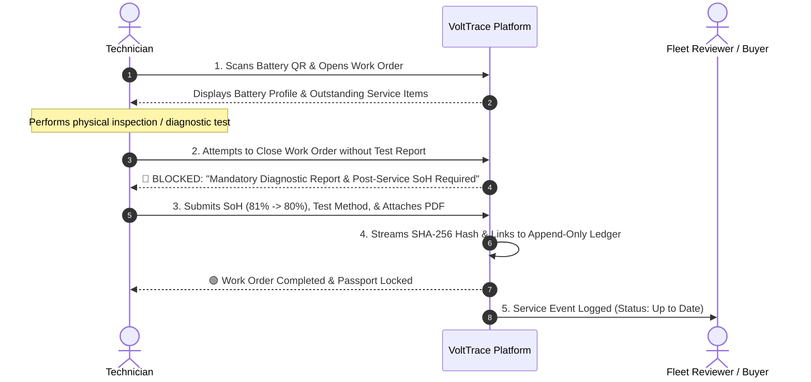
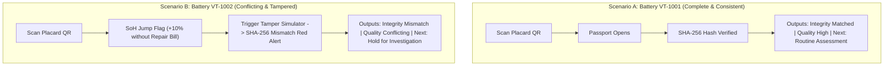

# VoltTrace — Every Battery Has a Story
### A Battery History Verification, Lifecycle Accountability, and Testing-Prioritisation Platform for EV Second-Life Applications

---

## 1. Executive Summary & Core Philosophy

**VoltTrace** is a digital battery passport platform that enforces service-record submission within participating workflows, verifies document integrity, detects historical inconsistencies, and helps buyers, refurbishers, and recyclers prioritise which EV batteries require further testing before reuse or recycling.

### The Central Problem
When an electric vehicle (EV) battery reaches the end of its first vehicle life, used battery buyers and recyclers lack a reliable way to verify available historical records, identify conflicting claims, and decide which packs require comprehensive physical testing.

Existing battery diagnostics measure present-day performance on the test bench, but a single test cannot authenticate seller documentation, reveal past hidden repairs, or identify whether a report was altered.

### Recommended System Positioning
> **VoltTrace is a *Battery History Verification and Testing-Prioritisation Platform*.**
>
> The digital passport is the interface; the distinctive technical contribution is combining **cryptographic document verification**, **rules-based consistency checking**, **mandatory service-update enforcement**, and **evidence-aware testing recommendations**.

### Epistemic Honesty (The Core Principles)
VoltTrace explicitly enforces four strict conceptual boundaries:
1. **Document Integrity $\ne$ Claim Truthfulness:** A matching SHA-256 hash proves an uploaded PDF has not been altered since registration; it does *not* prove the claims made within the document were truthful when generated.
2. **Digital Signature $\ne$ Safety Certification:** A valid Ed25519 cryptographic signature verifies that a document originated from a specific registered key holder; it does *not* guarantee the battery is physically safe.
3. **Current Diagnostic Condition $\ne$ Historical Evidence Quality:** A battery with a pristine paper trail may still have a defective cell, and a battery with no paperwork may have healthy cells. Physical condition and record reliability are reported separately.
4. **Missing Records = Uncertainty (Not Definite Fraud or Trouble-Free Operation):** A gap in service records indicates that the system lacks information about that period. It must widen the uncertainty band rather than being assumed as either trouble-free operation or fraud.

---

## 2. The 3-Pillar Decision Framework

VoltTrace **never** automatically declares a battery *"Approved for Residential Solar"* or *"Direct to Recycling"* based solely on historical records. 

Instead, the system evaluates the available evidence across **three separate, factual pillars**:

```
                              ┌─────────────────────────────────────────────────────────┐
                              │                    VOLTTRACE DOSSIER                    │
                              └─────────────────────────────────────────────────────────┘
                                       │                   │                   │
                     ┌─────────────────┴───────┐   ┌───────┴────────┐   ┌──────┴──────────────────┐
                     │ 1. RECORD INTEGRITY     │   │ 2. EVIDENCE    │   │ 3. RECOMMENDED NEXT     │
                     │                         │   │    QUALITY     │   │    ACTION               │
                     ├─────────────────────────┤   ├────────────────┤   ├─────────────────────────┤
                     │ • Verified Match        │   │ • High         │   │ • Routine Assessment    │
                     │ • Integrity Mismatch    │   │ • Limited      │   │ • Further Inspection    │
                     │ • Not Registered        │   │ • Conflicting  │   │ • Hold for Investigation│
                     └─────────────────────────┘   └────────────────┘   └─────────────────────────┘
```

### The Three Independent Results:

| Result Dimension | Possible Outputs | What It Means to the Buyer / Recycler |
| :--- | :--- | :--- |
| **1. Record Integrity** | `Verified Match` / `Mismatch Detected` / `No Reference Hash` | Whether the uploaded document matches the bitwise SHA-256 fingerprint registered in the system. |
| **2. Evidence Quality** | `High Confidence` / `Limited History` / `Conflicting Evidence` | How complete, consistent, and corroborated the available documentation is. |
| **3. Recommended Next Action** | `Routine Assessment` / `Further Inspection Required` / `Hold for Investigation` | The actionable next step the technician or buyer should take before financial settlement. |

### Separate Second-Life Suitability Assessment
Only when sufficient physical diagnostic data is available does the system provide a **Second-Life Suitability Assessment**, categorized into:
1. **Candidate for further second-life assessment** (All records consistent, capacity retention and impedance meet screening thresholds).
2. **Additional diagnostics or safety inspection required** (Uncertain history or measurement gaps require full bench testing).
3. **Refer for specialist evaluation or recycling assessment** (Critical anomalies, physical damage flags, or severe degradation).

> **Important:** Target applications (e.g., *Stationary Solar BESS*, *Telecom Tower UPS*, *Low-Speed Mobility*) are presented strictly as **Potential Applications to Evaluate**, never as pre-approved destinations.

---

## 3. VoltTrace 2.0 — Mandatory Service Updates & Event Ledger

A major weakness of static battery passports is the **"dead ledger" problem**: passports are rarely updated once the vehicle leaves the factory. VoltTrace introduces a workflow mechanism to keep the passport updated throughout the battery's active life.

### The Rule: "No Service Closure Without Record Submission"
Within participating fleet depots and authorized service centers, a technician **cannot complete or close a service work order in VoltTrace** without submitting the mandatory technical service data.



### Step-by-Step Service Workflow:
1. **Battery Identification:** The technician scans the placard QR code to open the active passport.
2. **Execution of Work:** Technician conducts diagnostic qualification, repair, or module replacement.
3. **Mandatory Field Submission:** To close the service event in VoltTrace, the technician must enter:
   * Service Type (e.g., *Diagnostic Qualification, Module Balancing, Annual Inspection*).
   * SoH Before Service & SoH After Service.
   * Testing Method & Test Equipment Used.
   * Components Replaced (conditional: only required if repairs were performed).
   * Authenticated Technician ID.
   * Supporting Diagnostic Document / Work Order PDF.
4. **Cryptographic Sealing:**
   * Backend computes the streaming SHA-256 hash of the uploaded document.
   * Service event is appended to the **Battery Service Event Ledger**.
   * Event links to the hash of the preceding event.
5. **Service Closure:** The work order status transitions to `COMPLETED`. If mandatory fields or files are missing, the work order remains `BLOCKED / PENDING_DOCS`.

### Battery Passport Record Status
Every battery profile displays a live recordkeeping status:

| Live Passport Status | Meaning |
| :--- | :--- |
| 🟢 **Up to Date** | All known service events have completed records submitted and verified. |
| 🟡 **Update Pending** | A service work order was initiated but remains incomplete without required documentation. |
| 🟠 **History Incomplete** | Expected chronological follow-ups are missing, indicating unrecorded operating periods. |
| 🔴 **Verification Issue** | An active document-integrity mismatch or high-priority anomaly requires investigation. |

---

## 4. Nuanced History & Discrepancy Detection Engine

Rather than applying a rigid, universal SoH threshold that produces false alarms, VoltTrace evaluates discrepancies using **context-aware heuristics**:
* Previous vs. current reported SoH.
* Test dates and elapsed operating time.
* Ambient test temperature ($^\circ\text{C}$) and test method (e.g., Coulomb Counting C/3 vs. OBD BMS readout).
* Reporting organization and source trust tier.
* Presence of documented repairs, recalibrations, or cell replacements.

### Discrepancy Classification

```
                                    DISCREPANCY CLASSIFICATION
                                                 │
        ┌────────────────────────────────────────┼────────────────────────────────────────┐
        ▼                                        ▼                                        ▼
   [CONSISTENT]                           [NEEDS REVIEW]                       [HIGH-PRIORITY ANOMALY]
Normal degradation curve        Minor variance attributable to            Severe mathematical or physical
(e.g., 86% -> 81% over          temperature, test C-rate, or              conflicts:
18 months; matching IDs)        recalibration tolerances                  • File SHA-256 mismatch
                                                                          • +10% SoH jump without repair bill
                                                                          • Diagnostic predating mfg date
```

* **Provisional Thresholds:** All numerical thresholds (e.g., $\pm 4\%$ margin for flat-curve LFP chemistry) are labeled as **provisional engineering rules** pending calibration against real-world test telemetry.

---

## 5. Cryptographic Verification Architecture

### A. Document Integrity (SHA-256)
* Ingestion uses memory-safe **64 KB streaming chunks** via Python's standard `hashlib.sha256`.
* Storage uses **Content-Addressable Storage (CAS)** outside the SQL database:  
  `./storage/documents/{battery_id}/{sha256_hash}.pdf`.
* Five distinct integrity outcomes:
  1. **Hash match:** The file matches the version previously registered in VoltTrace.
  2. **Hash mismatch:** The file differs from the registered reference hash (tampering detected).
  3. **No reference hash:** Integrity cannot be established against an earlier version.
  4. **Signature valid (Trusted Demo Issuer):** Verified against registered test public key.
  5. **Signature valid (Untrusted Issuer):** Signature is mathematically sound, but issuer is unregistered.

### B. Live Tamper Simulator Component
The application includes an interactive verification module for demonstrations:
* **Verify Authentic File:** Recalculates hash against the original $\to$ Displays **Green Match**.
* **Simulate File Tampering:** Recalculates hash against a 1-byte altered file $\to$ Instantly triggers **Crimson Mismatch Alert** with side-by-side hexadecimal hash comparison.

### C. Append-Only Audit Trail & Tamper Limitations
Every registration, service closure, and verification event appends to a hash-linked ledger:
$$\text{Event Hash} = \text{SHA256}(\text{Event Data} + \text{Timestamp} + \text{Previous Event Hash})$$

> **Honest Security Limitation:** A hash chain at the database level guarantees tamper-evidence against accidental modification, but **does not prevent an administrator with full database write access from rewriting the entire history and recomputing the chain**.  
> In production, external anchoring (e.g., publishing root hashes to an immutable ledger, RFC 3161 timestamping authority, or write-once cloud object storage) is required for full multi-party non-repudiation.

---

## 6. Physical Identification & The Industrial Placard

### Standards-Based Identification (No False Claims)
* Adheres to **GS1 Digital Link** URI standards: `https://volttrace.io/passport/{battery_id}`.
* Rendered via vector SVG QR code scannable by any standard smartphone camera or the in-app laptop webcam scanner.
* **Removal of Misleading Marks:** The generated placard explicitly features **Data Carrier & Standard Identifiers** (GS1 Digital Link, ISO 15118-20, DPP Carrier) rather than fake CE or safety marks that falsely imply VoltTrace physically certified the battery.

### Dual-Role Privacy & Access Control
* **Public Scan (Unauthenticated visitor/phone):** Displays the public battery card (Chemistry, original capacity, carbon footprint rating, safety/handling instructions, and recordkeeping status).
* **Technician Scan (Authenticated workshop/recycler):** Unlocks the full technical service history, raw diagnostic logs, SHA-256 integrity inspection, and discrepancy tracker.

---

## 7. The 3-Minute Live Demo Blueprint ("A Tale of Two Batteries")



### 1. Battery VT-1001 (The Consistent Battery)
* **Scan QR:** Digital passport opens instantly on screen.
* **Review History:** Natural electrochemical aging ($86\% \to 81.2\%$).
* **Verify Hash:** Click "Verify Authentic File" $\to$ **Green Check (Matched)**.
* **Three-Pillar Output:**
  * Record Integrity: **Verified Match**
  * Evidence Quality: **High Confidence**
  * Next Action: **Proceed to Routine Physical Assessment**
  * Second-Life Suitability: **Candidate for Further Assessment (e.g., Commercial Solar BESS)**

### 2. Battery VT-1002 (The Cheater / Tamper Demo)
* **Scan QR:** Passport opens with active amber warning.
* **Flag 1 (History Contradiction):** Diagnostic jumped from $74\%$ to $84\%$ SoH with **zero recorded repair invoice**.
* **Flag 2 (Live Hash Mismatch):** Click "Simulate File Tampering" $\to$ **Crimson Alert: SHA-256 Fingerprint Mismatch Detected!**
* **Three-Pillar Output:**
  * Record Integrity: **Mismatch Detected**
  * Evidence Quality: **Conflicting Evidence**
  * Next Action: **Hold for Investigation and Independent Qualification**
  * Second-Life Suitability: **Not Determined (Safety Hold)**

### The Closing Message for Judges:
> *"VoltTrace does not pretend to magically detect every defective battery with an algorithm.  
> It gives technicians an enforceable way to keep service records updated, detects document tampering, and highlights conflicting evidence so buyers know exactly which batteries need deep bench testing."*

---

## 8. Academic Viva & Defense Guide

| Tough Question from Judges | The Underlying Trap | Your Winning Technical Defense |
| :--- | :--- | :--- |
| **"Why records at all? Can't the recycler just test the battery?"** | Testing as a substitute for provenance | *"Testing measures the battery at this exact second. It cannot tell you if the pack had a thermal runaway event, was fast-charged at $-10^\circ\text{C}$, or was repaired with mismatched cells. Furthermore, testing takes 8–12 hours per pack; VoltTrace prioritises which batteries are worth testing in the first place."* |
| **"What if someone uploads a fake PDF? Your hash will still match!"** | Garbage In, Garbage Out | *"Correct. SHA-256 only guarantees data integrity post-upload. To combat false origin, we enforce the Mandatory Service Update workflow with authenticated technician IDs, pair files with our consistency engine, and require independent diagnostic intake corroboration."* |
| **"Why not Blockchain? A database admin can edit records."** | Centralized database skepticism | *"We use an append-only hash-linked audit log. While a database admin could rewrite history unless externally anchored, public blockchains incur high gas fees and directly violate data privacy laws like GDPR's 'Right to be Forgotten.' We explain this limitation honestly."* |
| **"Doesn't SoH fluctuate with temperature and test method?"** | Naive rule-based flagging | *"Yes. That is why VoltTrace does not use rigid binary thresholds. We classify variations into Consistent, Needs Review, and High-Priority Anomaly, recording ambient temperature and test equipment metadata alongside each reading."* |
| **"Who forces a workshop to update the passport?"** | Voluntary compliance failure | *"We integrate service recording into participating work-order workflows: a technician cannot complete or close a service order in VoltTrace without submitting the technical diagnostic data."* |

---

## 9. Technology Stack & File Structure

```
Volt-Trace/
├── PROJECT_DOCUMENTATION.md          # Master Architecture Specification
├── .gitignore                        # Standard ignore rules (node_modules, venvs, DBs)
├── start.sh                          # One-click startup script for backend & frontend
├── backend/
│   ├── app/
│   │   ├── api/
│   │   │   ├── routes_batteries.py   # Registry, 3-pillar details, search
│   │   │   ├── routes_documents.py   # Streaming upload, SHA-256, Ed25519 verify
│   │   │   ├── routes_service.py     # Mandatory Service Work Orders (VoltTrace 2.0)
│   │   │   ├── routes_diagnostics.py # Intake test entry & comparison
│   │   │   ├── routes_audit.py       # Hash-linked audit trail verification
│   │   │   └── routes_stats.py       # Executive dashboard summary statistics
│   │   ├── core/
│   │   │   ├── crypto.py             # SHA-256 chunked hashing & Ed25519 key verification
│   │   │   ├── rules_engine.py       # Context-aware discrepancy engine
│   │   │   └── triage_engine.py      # 3-pillar decision & testing prioritisation
│   │   ├── db/
│   │   │   ├── database.py           # SQLite connection with foreign keys & WAL mode
│   │   │   ├── models.py             # SQLAlchemy models (Battery, ServiceEvent, Document, etc.)
│   │   │   └── seed_data.py          # Seeds VT-1001 (Clean) and VT-1002 (Tampered)
│   │   └── main.py                   # FastAPI entrypoint with CORS & route mounting
│   └── requirements.txt
│
└── frontend/
    ├── src/
    │   ├── components/
    │   │   ├── BatteryPlacard.jsx    # GS1 Digital Link placard with vector QR code
    │   │   ├── QRScannerModal.jsx    # Webcam scanner using html5-qrcode
    │   │   ├── TriageDecisionCard.jsx# 3-Pillar decision card & next action recommendations
    │   │   ├── ServiceWorkOrderModal.jsx # Mandatory service closure workflow
    │   │   ├── SoHTimelineChart.jsx  # Recharts historical degradation timeline
    │   │   └── TamperSimulator.jsx   # Live SHA-256 fraud detection tool
    │   ├── pages/
    │   │   ├── Dashboard.jsx         # KPI overview & searchable battery registry
    │   │   └── BatteryDetail.jsx     # Master 9-section battery dossier
    │   ├── api.js                    # API client
    │   └── index.css                 # Clean, modern enterprise styling
    ├── package.json
    └── vite.config.js
```

---

## 10. Development Status

* [x] **Phase 1: Working Foundation:** FastAPI backend, SQLite database with seed data (`VT-1001` and `VT-1002`), React + Vite frontend, and basic CRUD.
* [x] **Phase 2: Cryptographic Demonstration:** Streaming SHA-256 hash engine, Ed25519 verification, and interactive Tamper Simulator.
* [ ] **Phase 3: VoltTrace 2.0 Enforced Workflow & 3-Pillar Decision Model:** Update triage card to the 3-Pillar outputs (`Record Integrity`, `Evidence Quality`, `Next Action`) and add the Mandatory Service Work Order modal (`routes_service.py` & `ServiceWorkOrderModal.jsx`).
* [ ] **Phase 4: Final Presentation Polish:** Placard label refinements, audit verification demo, and end-to-end dry run.
