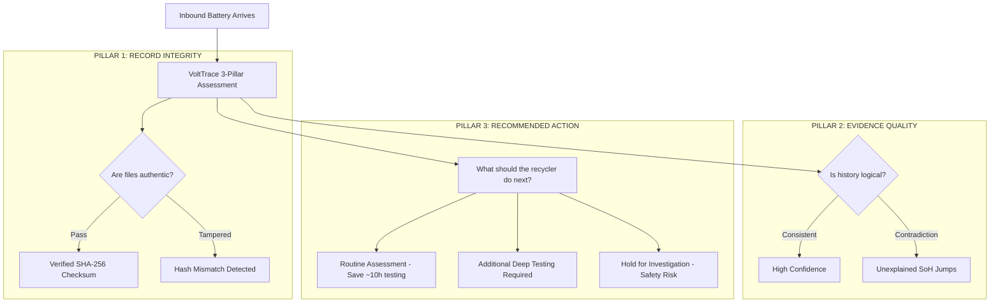

# 🔋 VoltTrace — Every Battery Deserves a Second Life

> **A Mission for Environmental Sustainability, Mineral Conservation, and Recycler Safety**  
> *Helping battery recyclers understand battery history, prevent premature e-waste, and safely give used EV batteries a second life.*

---

## 🌍 Table of Contents
1. [The Big Picture: Why This Matters to Society](#1-the-big-picture-why-this-matters-to-society)
2. [The Recycler's Dilemma](#2-the-recyclers-dilemma)
3. [The "Identical 82% SoH" Mystery: Why Testing Alone Fails](#3-the-identical-82-soh-mystery-why-testing-alone-fails)
4. [How VoltTrace Helps: The 3-Pillar Decision Framework](#4-how-volttrace-helps-the-3-pillar-decision-framework)
5. [The Cascading Second-Life Ladder](#5-the-cascading-second-life-ladder)
6. [Environmental Impact vs. Pure Profit](#6-environmental-impact-vs-pure-profit)
7. [Side-by-Side Comparison](#7-side-by-side-comparison)
8. [Complete 10-Slide Presentation Deck (PPT Guide)](#8-complete-10-slide-presentation-deck-ppt-guide)
9. [How to Run the Project Locally](#9-how-to-run-the-project-locally)

---

## 1. The Big Picture: Why This Matters to Society

Lithium-ion batteries power the electric vehicle revolution. But the critical materials inside them — **Lithium, Cobalt, Nickel, and Manganese** — are **finite natural resources**. 

```
   MINING RAW ORE                 CAR BATTERY RETIRED            THE TRAGIC OUTCOME
[ Deep earth mining ]  ──►  [ Reaches ~75-80% Capacity ]  ──►  [ Premature Shredding ]
  Massive water loss           75% ENERGY STILL INSIDE!          Waste of finite Earth
  High carbon toll             Can power solar for 8 yrs!        materials & energy
```

### The Uncomfortable Reality
* **Mining is ecologically expensive:** Producing just **1 kilogram of lithium** can consume over **2,000 liters of freshwater** and disrupt fragile ecosystems.
* **Batteries are retired too early:** An EV battery is usually retired from a car when it reaches **75% to 80% State of Health (SoH)** because the vehicle needs rapid highway acceleration.
* **The tragedy:** A battery with **75% health is not dead**. It still has enough storage capacity to power a village solar microgrid, a hospital backup generator, or an agricultural water pump for **7 to 10 more years**!

> **Our Mission:**  
> **VoltTrace exists to ensure that no healthy battery is needlessly shredded or dumped, and no compromised battery is dangerously reused.**

---

## 2. The Recycler's Dilemma

Imagine a recycling facility or second-life workshop receiving **500 used EV battery packs** in a single month.

The recycler wants to do what is best for the environment and their community. But they face three massive problems:

```
  PROBLEM 1: BLIND TRUST             PROBLEM 2: TIME & ENERGY BOTTLENECK       PROBLEM 3: SAFETY RISKS
"Did this pack overheat in 2024?     "Running a 12-hour charge-discharge      "If a damaged pack is put into a
 Has the seller edited the PDF?"      test on 500 packs consumes massive       school solar system, it could
                                      energy and takes weeks."                 catch fire."
```

If the recycler has to guess, they might shred good batteries out of caution, or sell a dangerous pack by accident. **VoltTrace gives recyclers the clear, verified facts they need to decide safely and quickly.**

---

## 3. The "Identical 82% SoH" Mystery: Why Testing Alone Fails

Some people ask: *"If a recycler can test the battery today, why do they need historical records?"*

Here is the answer that explains why physical testing alone is not enough:

```
┌──────────────────────────────────────────────┐    ┌──────────────────────────────────────────────┐
│           BATTERY A (Clean History)          │    │          BATTERY B (Hidden Danger)           │
├──────────────────────────────────────────────┤    ├──────────────────────────────────────────────┤
│ Today's Test Result: 82% Capacity            │    │ Today's Test Result: 82% Capacity            │
│ Measured Resistance: Normal                  │    │ Measured Resistance: Normal                  │
│ Both look IDENTICAL on the workbench!        │    │ Both look IDENTICAL on the workbench!        │
├──────────────────────────────────────────────┤    ├──────────────────────────────────────────────┤
│ Historical Truth:                            │    │ Historical Truth (Uncovered by VoltTrace):   │
│ • Regular OEM servicing                      │    │ • Overheated to 72°C during summer fast-charge│
│ • Passed every annual check                  │    │ • Unverified cell module swap in 2024        │
│ • Bit-for-bit verified documents             │    │ • Seller edited test PDF from 74% to 84%    │
├──────────────────────────────────────────────┤    ├──────────────────────────────────────────────┤
│ VERDICT: SAFE FOR SOLAR STORAGE (BESS)       │    │ VERDICT: HOLD! DANGEROUS INTERNAL STRESS     │
└──────────────────────────────────────────────┘    └──────────────────────────────────────────────┘
```

> **The Lesson:**  
> A multimeter and diagnostic cycler measure how a battery performs **at this exact second**.  
> **They cannot see yesterday's fire, last year's submerged flood, or a fake test certificate.**  
> VoltTrace connects physical test data with historical proof to reveal the full truth.

---

## 4. How VoltTrace Helps: The 3-Pillar Decision Framework

VoltTrace does not give a misleading "100% safe" guarantee (because software cannot guarantee hardware). Instead, it organizes evidence into **Three Clear Pillars** that any technician or buyer can understand in 5 seconds:



### Pillar 1: Record Integrity (Are the records genuine?)
* Every official birth certificate and lab test gets a digital fingerprint (**SHA-256**).
* If a seller edits a single number in a PDF, the fingerprint breaks instantly.
* **Status:** `Verified Authentic` 🟢 or `Mismatch Detected` 🔴.

### Pillar 2: Evidence Quality (Does the story make sense?)
* The automated rules engine scans for physical impossibilities:
  - *Did health jump from 74% to 84% without a repair receipt?*
  - *Did an odometer rollback occur?*
* **Status:** `High Confidence` 🟢, `Limited History` 🟡, or `Conflicting Evidence` 🔴.

### Pillar 3: Recommended Next Action (What should the human do?)
* **Routine Assessment:** Verified record -> Skip the exhausting 12-hour test -> Fast-track to second-life reuse!
* **Further Inspection:** Thin records -> Put on test cycler for full C/3 capacity benchmark before trusting.
* **Hold for Investigation:** Contradictions detected -> Quarantine immediately to protect human lives.

---

## 5. The Cascading Second-Life Ladder

VoltTrace supports the circular economy by recommending the most sustainable next path for every pack:

```
  HEALTH RETENTION               IDEAL SECOND-LIFE DESTINATION               ENVIRONMENTAL OUTCOME
 ┌─────────────────┐       ┌───────────────────────────────────────┐       ┌────────────────────────┐
 │   80% - 95%     │ ───►  │ Commercial & Industrial Solar (BESS)  │ ───►  │ Clean renewable energy │
 │   Very Healthy  │       │ Stores daytime solar for night use    │       │ replaces coal power    │
 └─────────────────┘       └───────────────────────────────────────┘       └────────────────────────┘
 ┌─────────────────┐       ┌───────────────────────────────────────┐       ┌────────────────────────┐
 │   65% - 79%     │ ───►  │ Telecom Towers & Warehouse UPS        │ ───►  │ Gentle float backup    │
 │   Moderate      │       │ Emergency power during grid outages   │       │ without high cycling   │
 └─────────────────┘       └───────────────────────────────────────┘       └────────────────────────┘
 ┌─────────────────┐       ┌───────────────────────────────────────┐       ┌────────────────────────┐
 │   50% - 64%     │ ───►  │ Agricultural Solar Water Pumps        │ ───►  │ Solar drip irrigation  │
 │   Low Demand    │       │ Off-grid village streetlight clusters │       │ for rural farmers      │
 └─────────────────┘       └───────────────────────────────────────┘       └────────────────────────┘
 ┌─────────────────┐       ┌───────────────────────────────────────┐       ┌────────────────────────┐
 │   Below 50%     │ ───►  │ Hydrometallurgical Closed Recycling   │ ───►  │ Recover 95%+ of pure   │
 │   End-of-Life   │       │ Recover Lithium, Nickel, Cobalt       │       │ cathode minerals       │
 └─────────────────┘       └───────────────────────────────────────┘       └────────────────────────┘
```

---

## 6. Environmental Impact vs. Pure Profit

Many software platforms focus on *"how much money can you sell this battery for?"*  
**VoltTrace is built on a different philosophy:**

| Focus Area | Typical Commercial Software | VoltTrace Philosophy |
| :--- | :--- | :--- |
| **Primary Goal** | Maximize battery resale profit margins | Conserve finite Earth minerals & ensure public safety |
| **Measurement** | Speculative market price predictions | **Testing-time saved** (hours) & **Critical minerals preserved** (kg) |
| **Low-Health Packs** | Dump or sell to highest unverified bidder | Route safely to closed-loop hydrometallurgical recycling |
| **Service Workflow** | Voluntary data entry (often skipped) | **Policy VT-202**: Service work orders cannot close without proof |
| **Transparency** | Black-box algorithm | Transparent mathematical rules & tamper-evident audit logs |

### The Real-World Metric: Testing-Time Saved
Testing a high-voltage battery on a qualification bench requires 8 to 12 hours of charging, discharging, and monitoring.
* **When records are verified:** Recyclers save **10.5 hours of testing per pack**.
* **When records are tampered:** Recyclers save **12 hours of wasted testing** by immediately catching the fraud.
* **Mineral Impact:** Keeping a 75 kWh battery in second life saves **~42 kg of raw Lithium, Nickel, and Cobalt**, avoiding **~84,000 Liters of freshwater mining**!

---

## 7. Side-by-Side Comparison

```
┌────────────────────────────────────────────────────────┬────────────────────────────────────────────────────────┐
│                   WITHOUT VOLTTRACE                    │                     WITH VOLTTRACE                     │
├────────────────────────────────────────────────────────┼────────────────────────────────────────────────────────┤
│ ❌ Recyclers test blindly without knowing battery past │ ✅ Recyclers prioritize testing based on true history  │
│ ❌ Overheated or flooded packs look fine on test bench │ ✅ Past safety bulletins and thermal flags highlighted │
│ ❌ Sellers can easily edit PDF test reports            │ ✅ SHA-256 digital checksum catches 1-byte edits       │
│ ❌ Good batteries shredded early out of legal fear     │ ✅ Clean batteries safely fast-tracked to solar storage│
│ ❌ Dead ledgers: nobody updates passport after sale    │ ✅ Mandatory work orders (Policy VT-202) enforce updates│
│ ❌ Millions of liters of water wasted on fresh mining  │ ✅ Existing batteries reused for 7-10 extra years     │
└────────────────────────────────────────────────────────┴────────────────────────────────────────────────────────┘
```

---

## 8. Complete 10-Slide Presentation Deck (PPT Guide)

Use this slide structure for competitions, hackathons, academic reviews, or industry presentations:

```
====================================================================================================
SLIDE 1: TITLE SLIDE
====================================================================================================
Headline:    VoltTrace — Every Battery Deserves a Second Life
Sub-headline: An Evidence-Based Battery Intelligence and Triage Platform for Sustainable Reuse
Speaker Note: "Good morning everyone. Today we are presenting VoltTrace, a system created to protect
              our environment, support recyclers, and make sure Earth's finite battery minerals are
              never wasted."

====================================================================================================
SLIDE 2: THE PROBLEM (FINITE PLANET, PREMATURE WASTE)
====================================================================================================
Key Visual:  Illustration of an open lithium mine next to an electric car battery.
Talking Pts: • Electric cars are great, but the Lithium, Nickel, and Cobalt inside them are finite.
             • Mining 1 kg of Lithium requires up to 2,000 liters of freshwater.
             • When an EV battery retires at 80% health, 80% of its clean energy capacity remains!
             • If we shred it today, we waste all that energy. But how can we reuse it safely?

====================================================================================================
SLIDE 3: THE RECYCLER'S DILEMMA
====================================================================================================
Key Visual:  Recycler looking at a warehouse of 500 incoming batteries with question marks.
Talking Pts: • Recyclers receive hundreds of used packs every month.
             • Full electrical testing takes 10 to 12 hours per battery.
             • Recyclers have no easy way to know: Was this pack abused? Was a PDF altered?
             • Result: Many good packs are shredded out of caution, while unsafe packs slip through.

====================================================================================================
SLIDE 4: THE IDENTICAL 82% SoH MYSTERY (THE CRUCIAL COMPARISON)
====================================================================================================
Key Visual:  Side-by-side comparison of Battery A and Battery B (both showing 82% SoH).
Talking Pts: • Battery A and Battery B both measure 82% health on today's test bench.
             • Battery A is clean, gentle, and verified.
             • Battery B suffered a 72°C thermal incident and a cheap unrecorded module swap.
             • Takeaway: Today's physical test cannot see yesterday's damage. We need provenance!

====================================================================================================
SLIDE 5: THE VOLTTRACE SOLUTION — 3-PILLAR DECISION FRAMEWORK
====================================================================================================
Key Visual:  The 3 Pillars graphic (Integrity 🟢 | Evidence 🟢 | Recommended Action 🟢).
Talking Pts: • VoltTrace does not give false safety guarantees.
             • Pillar 1: Record Integrity (Did anyone edit the file? Checked via SHA-256).
             • Pillar 2: Evidence Quality (Are there timeline gaps or impossible health jumps?).
             • Pillar 3: Actionable Next Step (Routine Check, Further Testing, or Safety Hold).

====================================================================================================
SLIDE 6: HOW IT WORKS IN PRACTICE (DEMO WALKTHROUGH)
====================================================================================================
Key Visual:  Vector QR Placard + Live Tamper Simulator screenshot.
Talking Pts: • Each pack gets an industrial GS1 QR code placard linking to its permanent passport.
             • Our Live Tamper Simulator proves that modifying a single byte in a report turns the
               badge from green to red instantly.
             • Recyclers scan the QR code and know within seconds what physical test is needed.

====================================================================================================
SLIDE 7: REAL-WORLD PROBLEM SOLVED — POLICY VT-202 (NO MORE DEAD LEDGERS)
====================================================================================================
Key Visual:  Service work order locked icon unlocking only when diagnostic report is attached.
Talking Pts: • Why do ordinary battery passports fail in real life? Because people forget to update them!
             • VoltTrace introduces Policy VT-202: A service workshop cannot close an official work
               order in their software without attaching an accredited diagnostic report.
             • This ensures the passport stays alive and updated throughout the battery's entire life.

====================================================================================================
SLIDE 8: THE CIRCULAR SECOND-LIFE LADDER
====================================================================================================
Key Visual:  Cascading diagram from Solar BESS ──► Telecom UPS ──► Solar Streetlights ──► Recycling.
Talking Pts: • We don't just dump or approve. We cascade!
             • 80%+ SoH: Commercial & Industrial Solar Storage (Peak Shaving).
             • 70% SoH: Telecom tower emergency backup.
             • Below 50%: Clean hydrometallurgical recycling to recover raw minerals back into new EVs.

====================================================================================================
SLIDE 9: ENVIRONMENTAL & SOCIETAL IMPACT (NOT PROFIT-DRIVEN)
====================================================================================================
Key Visual:  Impact stats: 10.5h cycler time saved • 42 kg minerals saved • 84,000L water saved.
Talking Pts: • VoltTrace is not about stock trading or resale arbitrage.
             • It saves valuable test-bench electricity and labor for recyclers.
             • It keeps heavy metals out of landfills and gives communities safe clean solar power.
             • Every battery kept in second life delays the need to mine more virgin Earth ore.

====================================================================================================
SLIDE 10: CONCLUSION & VISION
====================================================================================================
Key Visual:  A battery symbol turning into a green sprout / renewable sun.
Talking Pts: • "Every battery deserves a safe second life before it is recycled."
             • VoltTrace provides the missing trust bridge between vehicle dismantlers, second-life
               builders, and recyclers.
             • Clean technology, safe communities, and a sustainable future for our planet. Thank you!
====================================================================================================
```

---

## 9. How to Run the Project Locally

VoltTrace is built as a lightweight, lightning-fast full-stack web application:
* **Backend:** Python 3.12, FastAPI, SQLite with WAL mode, Ed25519 Cryptography, Streaming SHA-256.
* **Frontend:** React 19, Vite, Recharts, Lucide Icons, QR Code Generator & Scanner.

### Quick Start (One Command)
Clone the repository and run the startup script:

```bash
git clone https://github.com/Jeevan0714/Volt-Trace.git
cd Volt-Trace
chmod +x start.sh
./start.sh
```

### Accessing the Web Application
* **Interactive Dashboard:** [http://localhost:5173](http://localhost:5173)
* **FastAPI Backend Docs (Swagger):** [http://127.0.0.1:8000/api/v1/docs](http://127.0.0.1:8000/api/v1/docs)

### Try the Live Demonstration
1. Open the Dashboard at `http://localhost:5173`.
2. Click **VT-1001**: See a verified battery with passing SHA-256 hashes, high evidence score, and **~10.5 hours of saved cycler bench testing**.
3. Click **VT-1002**: See the cheater detection demo! The system instantly catches a 1-byte altered seller report, flags an impossible +10% SoH jump, and places the pack on **Safety Hold**.
4. Test the **Live Tamper Simulator**: Edit a file live and watch the cryptographic fingerprint detect tampering in real time.
5. Test **Policy VT-202**: Open a service work order and attempt to close it without diagnostic proof to see automated closure blocking in action.

---

## 🌿 License & Open Source Commitment
Developed with dedication to circular economy principles, open data standards (EU DPP Regulation 2023/1542, CIRPASS DPP, India BWMR 2022), and environmental stewardship.
